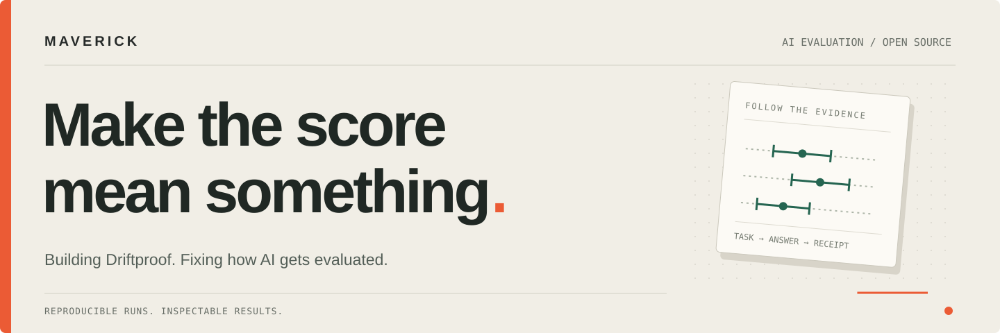

<picture>
  <source media="(prefers-color-scheme: dark)" srcset="assets/banner-dark.svg" />
  
</picture>

<a href="https://github.com/driftproofhq/driftproof"><b>↗ Driftproof</b></a> &nbsp;&nbsp;·&nbsp;&nbsp;
<a href="https://zenodo.org/records/24136677">Paper</a> &nbsp;&nbsp;·&nbsp;&nbsp;
<a href="https://driftproofhq.com/writing/three-releases/">Writing</a> &nbsp;&nbsp;·&nbsp;&nbsp;
<a href="https://driftproofhq.com/measure/">Free skill check</a> &nbsp;&nbsp;·&nbsp;&nbsp;
<a href="https://github.com/pulls?q=is%3Apr+author%3Amavericksea-ai+is%3Apublic+-org%3Adriftproofhq+-user%3Amavericksea-ai">Contributions</a> &nbsp;&nbsp;·&nbsp;&nbsp;
<a href="mailto:hello@driftproofhq.com">Get in touch</a>

I’m **Maverick**, building [Driftproof](https://driftproofhq.com) and contributing to the tools that evaluate AI models and agents.

I work on a deceptively simple question: **did the system actually measure what its score says it measured?** That has led me from missing execution evidence to inflated metrics, stale grading, and results attributed to the wrong model.

## 01 / Building Driftproof

**Agent skills change. Models change. Their evaluations should keep up.**

Driftproof runs the same tasks with a skill, without it, and with a same-length placebo, samples answers and judge scores, and writes dated, hash-verified receipts. It gives you results to inspect and compare when the model underneath a skill changes.

<table>
<tr>
<td width="50%" valign="top">
<h3>Use the instrument</h3>

Evaluate a skill against a baseline and inspect the evidence behind the result.

<a href="https://github.com/driftproofhq/driftproof"><b>Explore the source →</b></a>
</td>
<td width="50%" valign="top">
<h3>Read the findings</h3>

Latest report, on Fable 5.2: 10 of 20 skills beat a same-length placebo, 4 did not, and 6 could not be told apart.

<a href="https://driftproofhq.com/reports/019/"><b>Report 019 →</b></a> &nbsp;·&nbsp; <a href="https://driftproofhq.com/writing/three-releases/">Three model releases later</a>
</td>
</tr>
</table>

**Not sure a skill of yours still helps?** Send it and I will measure it for free on Haiku 5.5 and Sonnet 5.5, against no skill and against a placebo, and publish the result whatever it says. Text-only skills, first 50 requests. [Request a measurement →](https://driftproofhq.com/measure/)

## 02 / Fixes that shipped

Selected from 15 merged pull requests in 5 projects I use and study. The pattern behind them is written up in [Reported, Not Measured](https://zenodo.org/records/24136677) (version 2, November 2026): 26 defects in 15 evaluation tools, each one reproduced, 13 fixed upstream so far.

| Where | Why the fix matters |
| :--- | :--- |
| **NVIDIA · SkillEvaluator** | Credit must follow evidence: reading a script is not running it, a failed command is not a clean first attempt, and a total must follow from its own verdicts. [Require invocation evidence ↗](https://github.com/NVIDIA/SkillEvaluator/pull/154) · [Score unrecovered failures ↗](https://github.com/NVIDIA/SkillEvaluator/pull/217) · [Derive totals from verdicts ↗](https://github.com/NVIDIA/SkillEvaluator/pull/190) |
| **ModelScope · EvalScope** | Unrecognized answers must not disappear from recall and F1 denominators. [Correct PubMedQA scoring ↗](https://github.com/modelscope/evalscope/pull/1828) |
| **MLflow** | Relative score checks must handle negative baselines correctly. [Use the baseline’s magnitude ↗](https://github.com/mlflow/mlflow/pull/26252) |
| **Alibaba · skill-up** | Tool argument rules need the argument structure preserved. [Fix judge matching ↗](https://github.com/alibaba/skill-up/pull/304) |
| **Addy Osmani · agent-skills** | Grades must match declared expectations and the current run. [Bind expectation IDs ↗](https://github.com/addyosmani/agent-skills/pull/576) · [Clear stale grading ↗](https://github.com/addyosmani/agent-skills/pull/587) |

More merged work

- agent-skills [#578](https://github.com/addyosmani/agent-skills/pull/578): Preserve on-disk edits when expanding simplify-ignore sections.
- agent-skills [#598](https://github.com/addyosmani/agent-skills/pull/598), [#615](https://github.com/addyosmani/agent-skills/pull/615): Align ADR grading and templates with the expected status and date.
- agent-skills [#600](https://github.com/addyosmani/agent-skills/pull/600), [#614](https://github.com/addyosmani/agent-skills/pull/614): Strengthen floor-guard checks for untracked files, deletions, thresholds, and diff parsing.
- agent-skills [#694](https://github.com/addyosmani/agent-skills/pull/694): Make the security and accessibility gate examples fail the build on blocking findings.
- SkillEvaluator [#242](https://github.com/NVIDIA/SkillEvaluator/pull/242): Add opt-in character facts so a judge can tell a non-breaking space from a plain space.

## 03 / Open-source activity

<!-- activity:start -->
<table>
<tr><td width="50%" valign="top"><h3>↗ Recently active · merged</h3>

<a href="https://github.com/addyosmani/agent-skills/pull/694"><b>addyosmani/agent-skills #694</b></a> fix(constraints): enforce security and accessibility quality gates

<a href="https://github.com/NVIDIA/SkillEvaluator/pull/242"><b>NVIDIA/SkillEvaluator #242</b></a> Add opt-in Unicode character facts for Tier 3 judges

<a href="https://github.com/NVIDIA/SkillEvaluator/pull/217"><b>NVIDIA/SkillEvaluator #217</b></a> fix(tier3): score unrecovered failures and align recovery verdicts

</td><td width="50%" valign="top"><h3>◌ Under review</h3>

<a href="https://github.com/addyosmani/agent-skills/pull/667"><b>addyosmani/agent-skills #667</b></a> feat(evals): record behavioral runs for historical regrading

<a href="https://github.com/promptfoo/promptfoo/pull/12005"><b>promptfoo/promptfoo #12005</b></a> feat(eval): add character facts template filter

<a href="https://github.com/langchain-ai/openevals/pull/293"><b>langchain-ai/openevals #293</b></a> Add optional character facts for Unicode-sensitive judging

</td></tr>
<tr><td colspan="2" valign="top"><h3>Reported issues</h3>

<a href="https://github.com/NVIDIA/SkillEvaluator/issues/241"><b>NVIDIA/SkillEvaluator #241</b></a> [BUG]: Tier 3 goal-accuracy judge can misgrade NBSP-sensitive answers

<a href="https://github.com/addyosmani/agent-skills/issues/432"><b>addyosmani/agent-skills #432</b></a> Drift data for 3 of these skills across the sonnet-4-6 → sonnet-5 release

<a href="https://github.com/BerriAI/litellm/issues/45830"><b>BerriAI/litellm #45830</b></a> [Bug]: Anthropic batch accounting undercounts 1h cache writes and omits web-search fees

</td></tr>
</table>
Public external PRs and issues · ordered by latest activity · refreshed 2026-11-14 UTC.
<!-- activity:end -->

---

**Working on agent skills or evaluation infrastructure?** I’m interested in reproducible failures, useful tools, and getting the measurement right.

[hello@driftproofhq.com](mailto:hello@driftproofhq.com) · [driftproofhq.com](https://driftproofhq.com)

Contribution statuses checked November 13, 2026.
